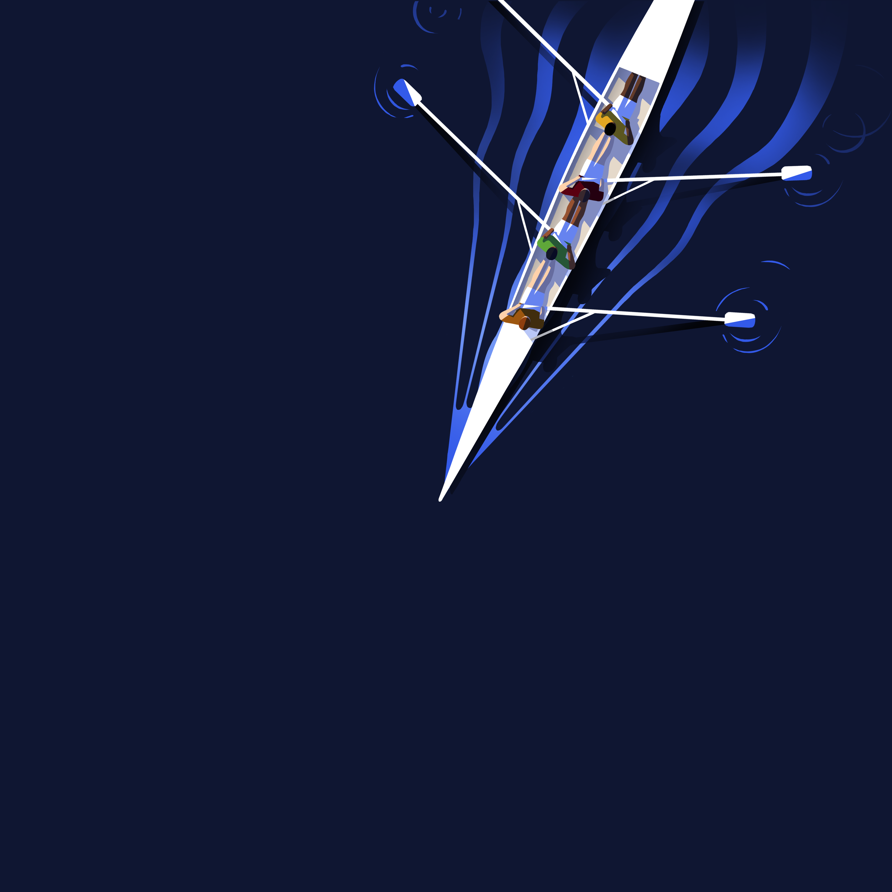
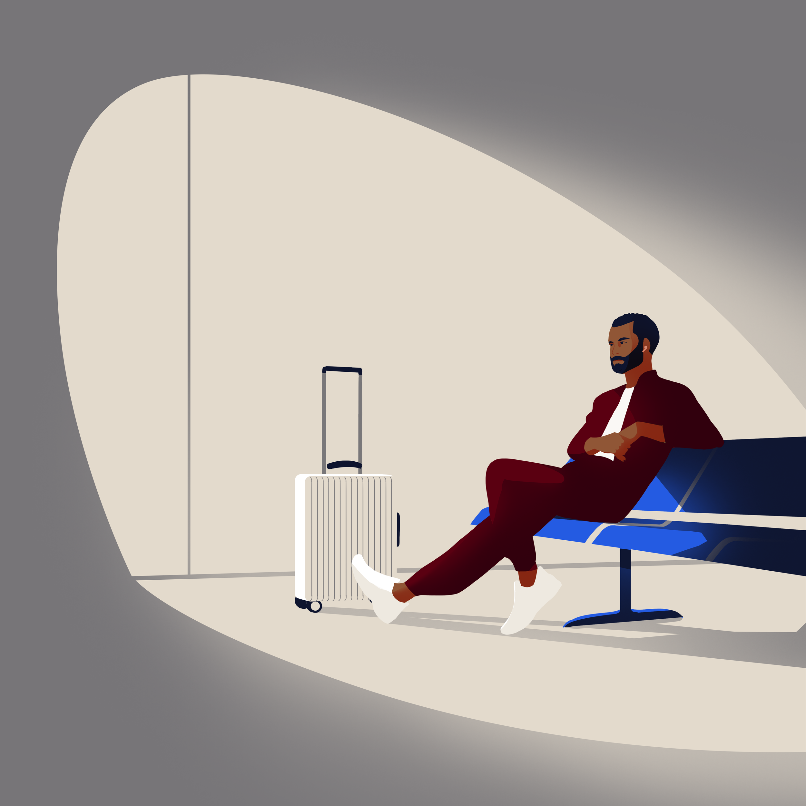
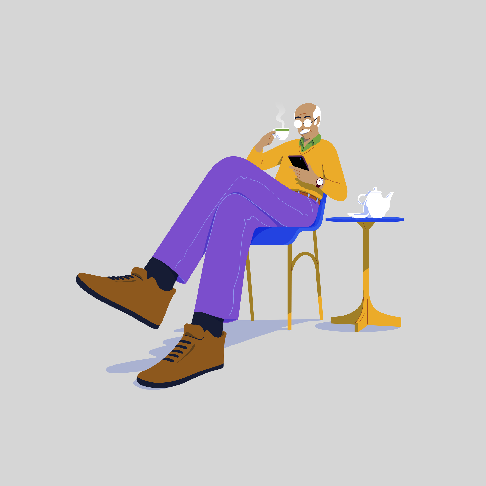
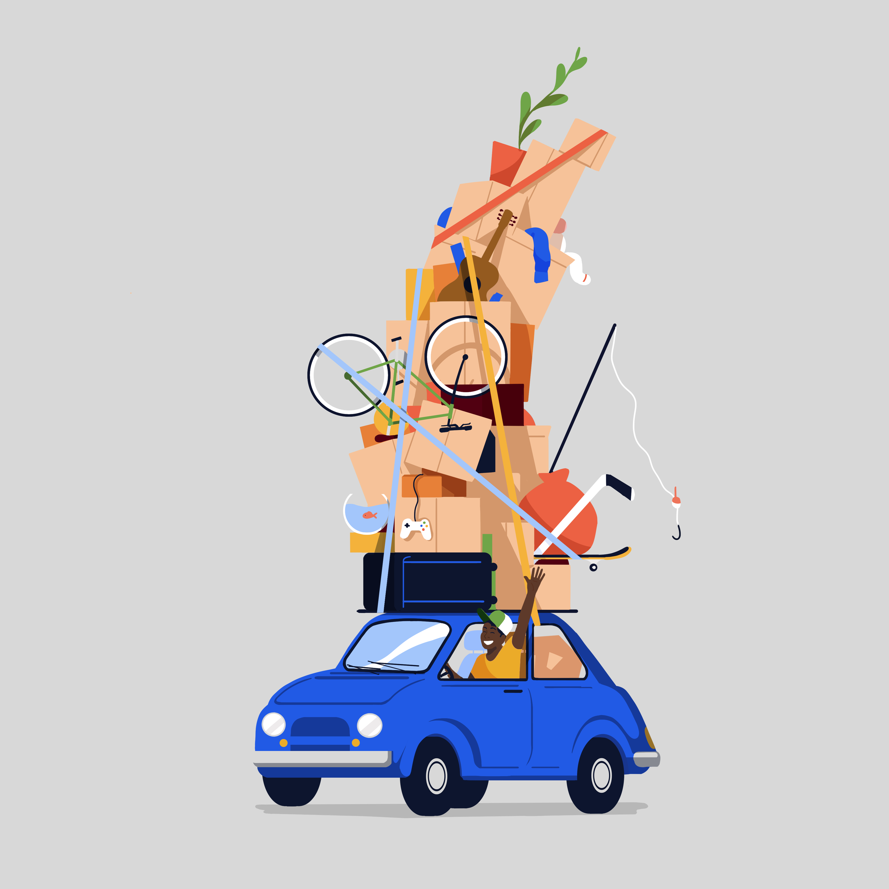

# Citibank — Illustrations

*Role:* Art Director

*Studio:* BUCK

*Client* : Turner Duckworth / Citibank

Two sets of illustrations built for the Citi brand, meant to speak to two of their most important groups of clients — institutions and everyday banking customers.

Institutional clients include some of the biggest companies in the world, so this first set of illustrations had to speak to the issues and scenarios that these businesses consider each day — from cultural differences across world markets, to the future of energy and transportation.

This set of illustrations were intentionally restrained; making minimal use of light and shadow to bring dimensionality without overdoing it.

The consumer illustrations needed to cover more down to earth activities — from the weekly groceries to a new home mortgage. We embraced exaggeration, amplifying parts of the design in order to add energy to a moment, draw attention to the message, or emphasize motion & action.

People and objects are rooted in fairly realistic anatomy and proportions, with exaggeration applied to emphasize mood, action, or pull focus. With nuanced facial expressions and dynamic body language, all allowing personal style to come to the fore.

The final component was a set of dynamic, abstract 3D background elements, inspired by the arc in the Citi logo. Materials and textures were used that exude luxury and opulence (such as silk or satin), all in service of making these forms feel tangible, familiar, and high-end.

Lighting was used to bring depth and dimension to the shape; highlights picking out edges of folds, shadows pushing things back in space.

The motion of the abstract 3D sculpture brings the dynamic form to life. Evoking a sense of evolution, movement, tension and release.

[Video — video-01-43aada20-3f91-49ae-9ec5-5fd3d02c43ed.mp4 (Squarespace-hosted, 10s)](./citi/video-01-43aada20-3f91-49ae-9ec5-5fd3d02c43ed.mp4)

## Credits

**Group Creative Director**
Thomas Schmid

**Executive Producer**
Kitty Dillard

**Creative Director**
Jon Gorman

**Associate Creative Director**
Amelia Giller

**Art Director**
Doug Hindson

**Producers**
Alexi Yeldezian, Gwynne Evans Reid

**Production Cooordinator**
Jacklyn Reid Hemmings

**Design**
Amelia Chen, Hanna No, Joao Lavieri, Johan Papin, Xia Gordon

**3D**
Richard Dixon, Taylor James, Tina Chao
