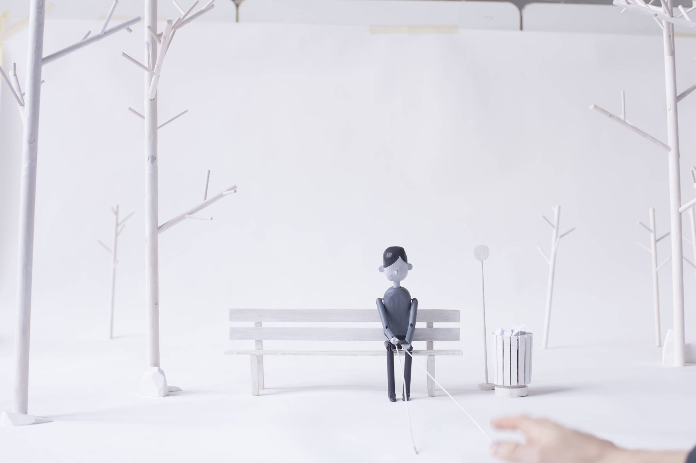

# Dis\Connect

[Video — video-01-795c6ccb-7f84-44ec-820e-5480c57abb83.mp4 (Squarespace-hosted, 155s)](./disconnect/video-01-795c6ccb-7f84-44ec-820e-5480c57abb83.mp4)

*Role:* Director, Designer, Writer, Fabricator

A search for higher meaning, dissatisfaction with the status quo and a sense that you’re the first person to feel this way. You're not. A semi-satirical coming of age story told by handmade wooden puppets.

## "This quiet, unassuming short with a truly excellent and funny script is tearjerkingly perfect."

[It’s Nice That](http://www.itsnicethat.com/articles/doug-hindson-disconnect)

‘DIS \ CONNECT’ was my graduation film from the Illustration & Animation course at Kingston University. All models and sets were hand-made from wood & card, hundreds of individual pieces were designed, cut, sanded, glued and painted. Rather than stop-motion, the film was shot live-action with strings and rods controlling the puppets and everything was captured in-camera.

Awarded a [Vimeo Staff Pick](https://vimeo.com/116533375).

[Video — video-02-94fbbd45-918d-443c-af26-f6654652ce8b.mp4 (Squarespace-hosted, 100s)](./disconnect/video-02-94fbbd45-918d-443c-af26-f6654652ce8b.mp4)

## Credits

**Direction, Design, Story** Doug Hindson

**Voiceover**
Tom Hillenbrand

**Sound Design**
James Green

**Additional Model Making**
Pedro Foppa

**Additional Puppetry**
Thea Glad, Matt King, Gus Scott, Sam Stobart, Imogen Woolley
