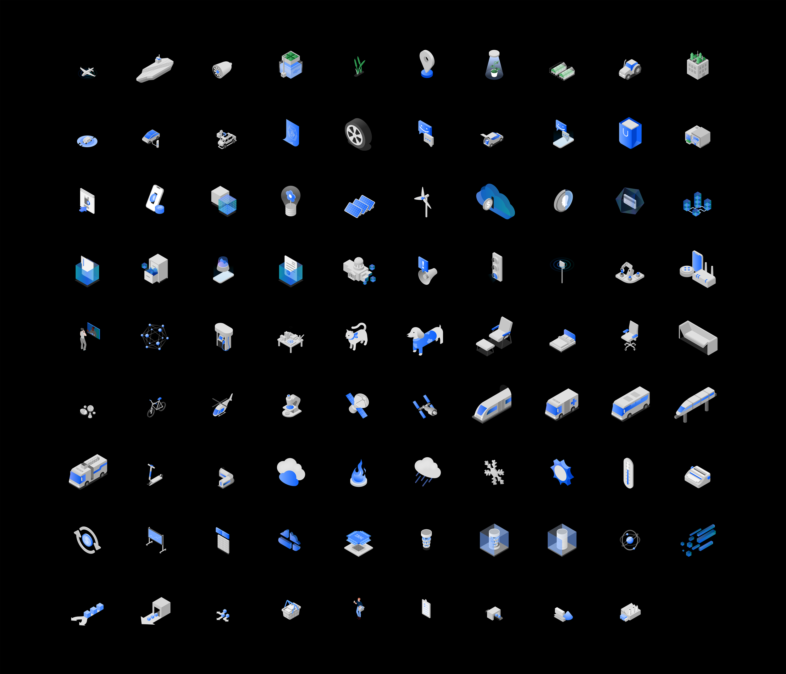

# IBM — Illustrations

*Role:* Associate Creative Director, Art Director, Designer

*Studio:* BUCK

*Client:* IBM

IBM has developed a rigorous design system over the decades, with a thorough consideration for every detail covering a broad range of different brand expressions.

BUCK built out a varied set of illustrations, meant to show the full breadth of visual concepts that might need to be represented, while staying within the constraints of the IBM design language.

The IBM design system is anchored around a grid system, so each shape needs to carefully adhere to regular increments of scale and spacing. Respecting a visual hierarchy and allowing for usage across a wide range of placements.

Each illustration tackled a broad theme — from practical concepts like ‘security’ and ‘cloud computing’, to more amorphous ideas like 'problem solving’.

Alongside the broader set of conceptual illustrations, we were also tasked with developing a robust array of icons that would cover specific topics whilst working across many different applications.

These icons were rooted in the isometric IBM design language, and had to be able to be able to be scaled across many sizes, and work against both light and dark environments.

## Credits

**Group Creative Director**
Jon Gorman

**Executive Producer**
Kitty Dillard

**Producer**
Bess Howell

**Senior Art Director**
Doug Hindson

**Design**
Carmel Gatchalian, Amelia Chen, Jose Flores, Mike Ellis
