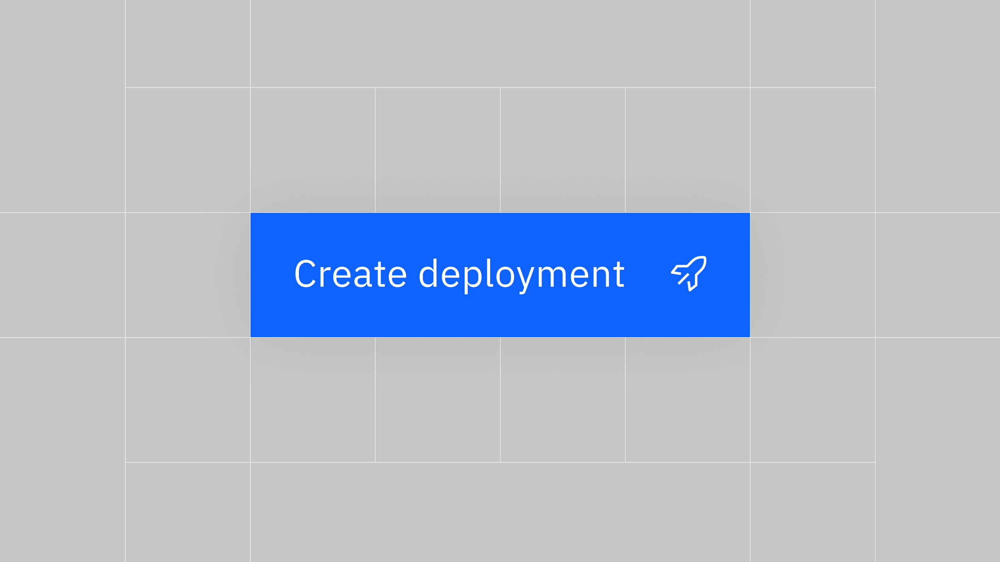
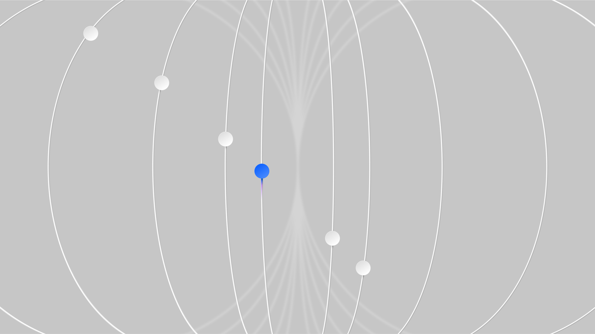

# IBM — watsonx

[Video — video-01-e2809873-ef74-4171-9baa-29a4029a3f6f.mp4 (Squarespace-hosted, 100s)](./ibm-watsonx/video-01-e2809873-ef74-4171-9baa-29a4029a3f6f.mp4)

*Role:* Art Director

*Studio:* BUCK

*Client:* IBM

Building on the Watson name and its established reputation for advancing AI, BUCK worked closely with IBM’s Blue Studio to reimagine *watsonx* as the new face of AI within IBM’s impressive enterprise solutions.

BUCK built a visual system around the insight that while AI models can produce infinite outcomes from a singular idea, it is how they’re trained and tuned that brings focus and organization to the potential chaos of the AI landscape.

The idea for our concept stemmed from AI acting as a catalyst — a multiplying force — that iterates and amplifies an original idea. Inspired initially by fractals and patterns that occur in nature, a singular 2D circle multiplies to form complex, organized 3D structures.

[Video — video-02-3f1dbe5d-75fc-4f9f-8e3c-670df53cb2eb.mp4 (Squarespace-hosted, 5s)](./ibm-watsonx/video-02-3f1dbe5d-75fc-4f9f-8e3c-670df53cb2eb.mp4)

The outcome is a versatile visual language that captures watsonx’s core elements as a suite of unique states, each capable of transitioning seamlessly from 2D vector designs to intricate 3D visualizations.

Along with a broader suite of companion designs and visual mechanisms to explain the breadth and nuance of this new platform.

## Credits

**Group Creative Directors**
Daniel Oeffinger, Jon Gorman

**Executive Producer**
Kitty Dillard

**Creative Director**
Stevie Watkins

**Producer**
Tracey McDonough

**Production Coordinator**
Khadim Dieng

**Senior Art Directors**
Doug Hindson, Guillermo Zapiola

**Copywriting**
Dave Evans, Charlie Short

**Design**
Vincenzo Lodigiani, Emilia Tonello, Yukyung Lee, Nejc Polovsak, Simon Ronnerdag

**2D Animation**
Peter Harp, Nilsson Cajamarca, Filipe Consoni, James Kim, Raz Gadhyia, Justin Lawes, Marcus Bakke, David Hobizal, Yussef Cole

**3D Animation**
Will Burkart, Chris Ribar, Javier Tommasi, Antian Imeri, Tina Chao, Nachei Sanchez, Kevin Weber

**Audio**
Antfood
