# Landscapes

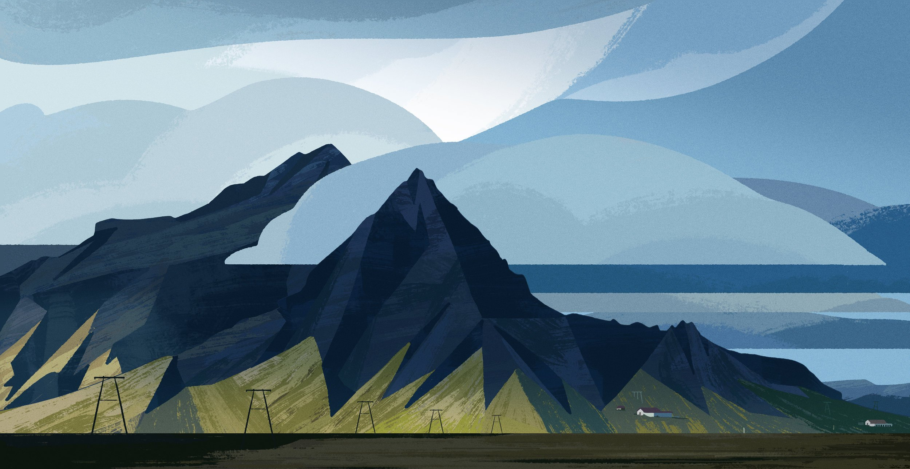

*Role:* Design

A selection of personal environment designs & paintings from across the years. Inspired by the far flung places I’ve explored, and some I’ve yet to visit.

Click on any image to view it full screen.

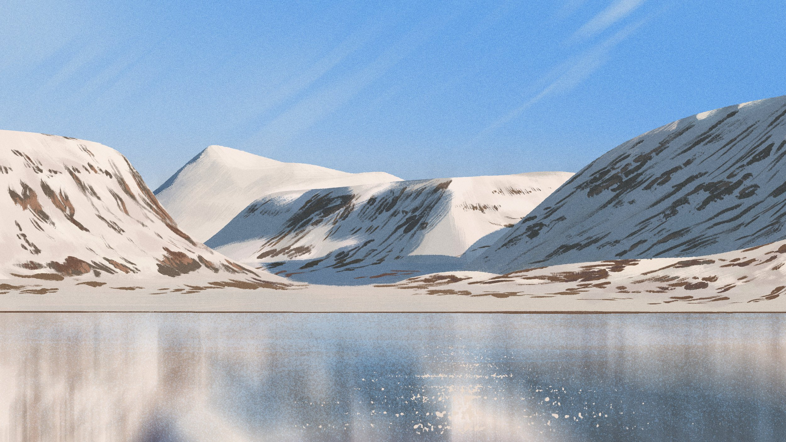
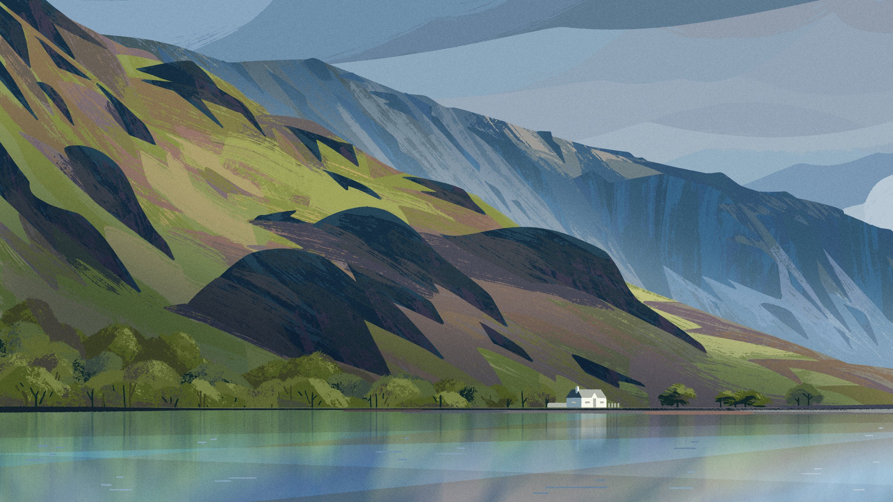

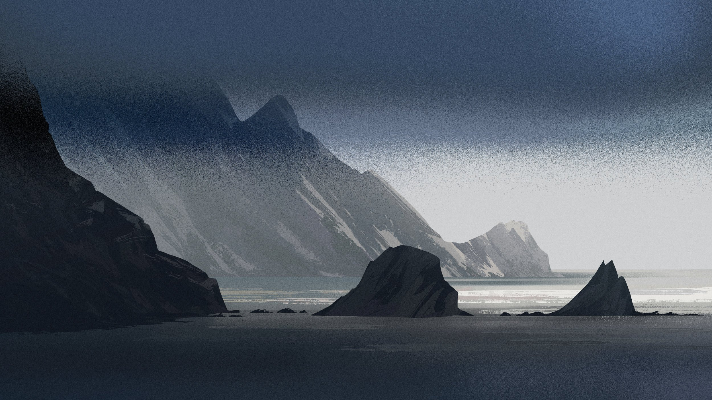
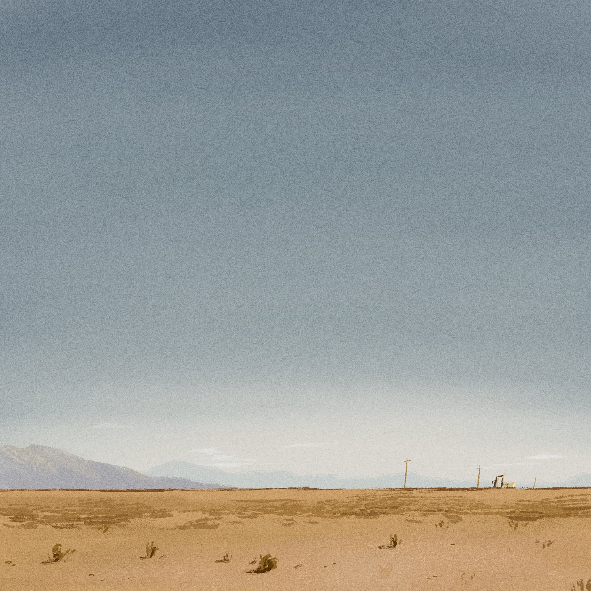
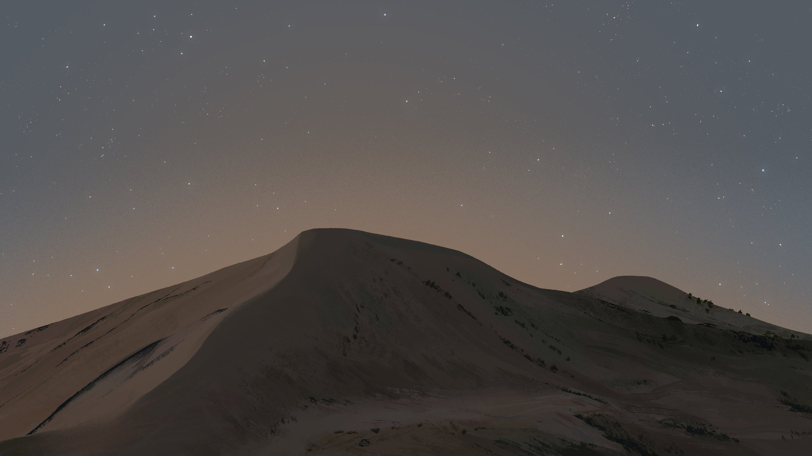
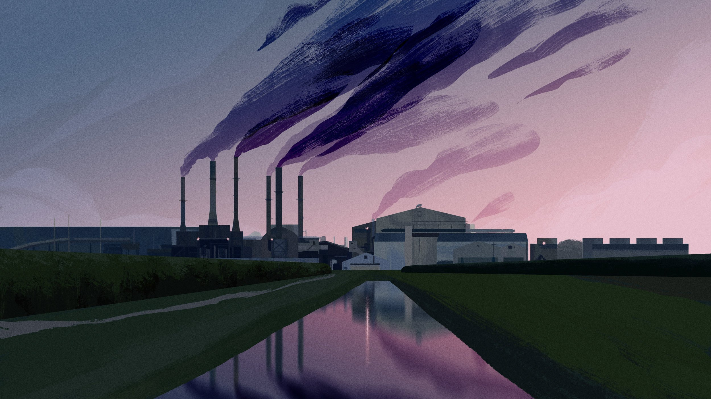
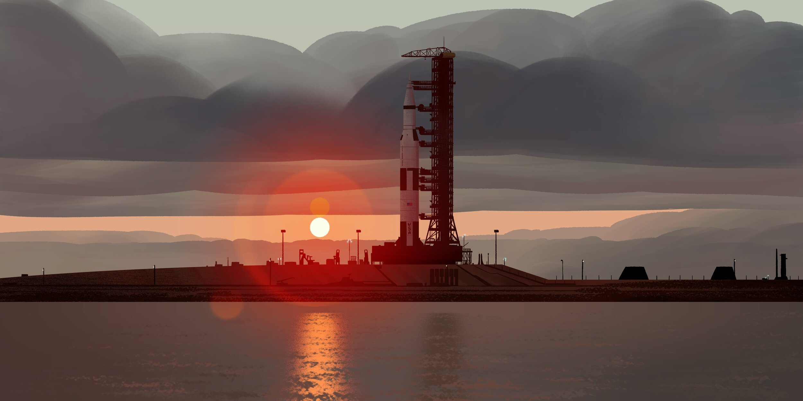
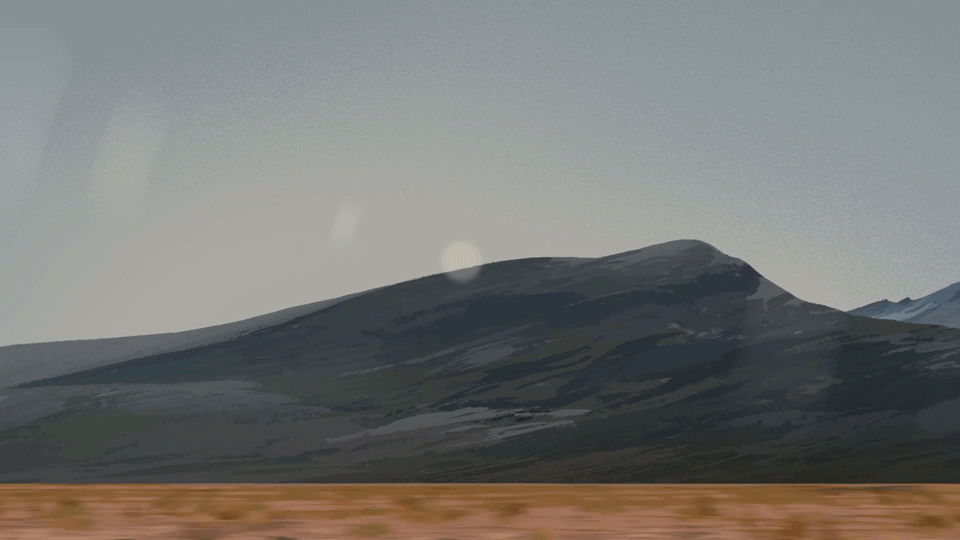
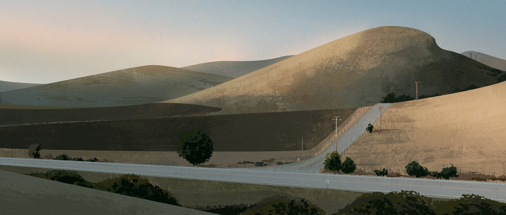
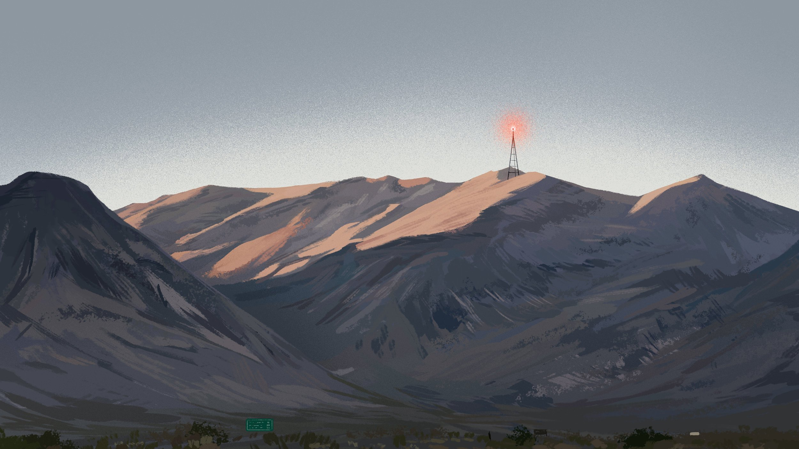
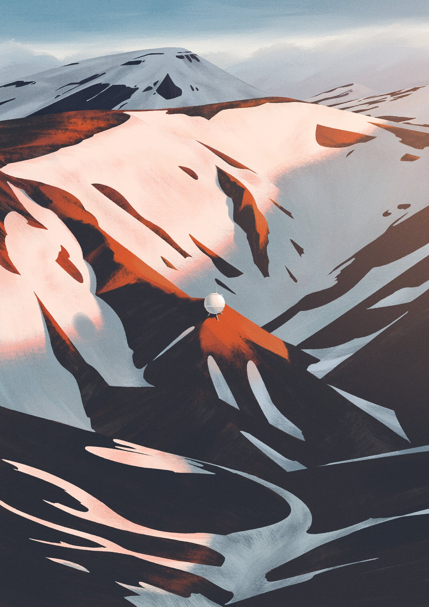
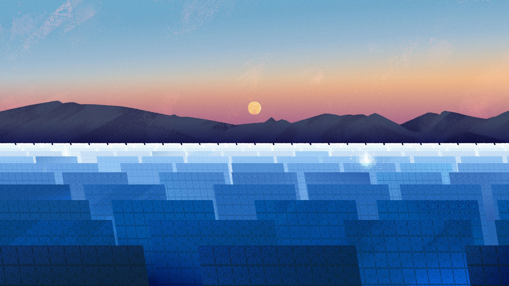
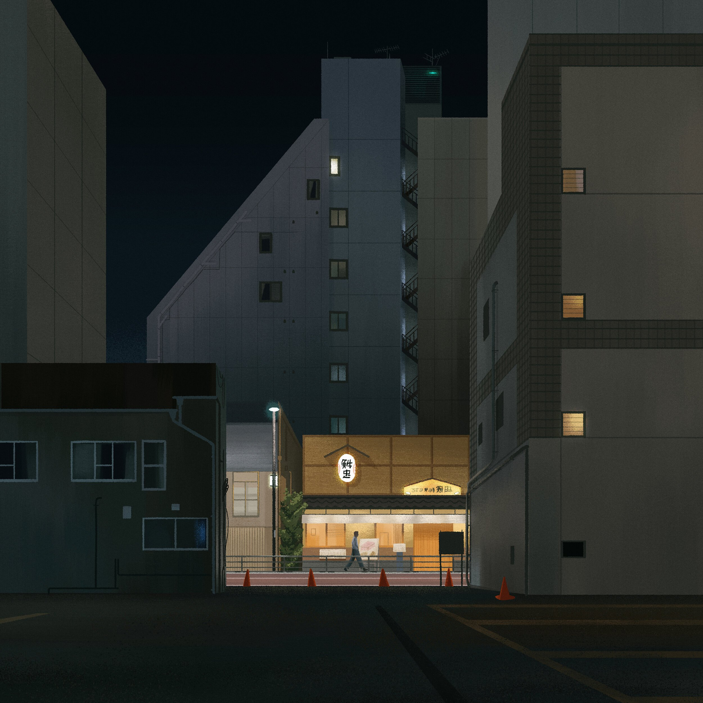
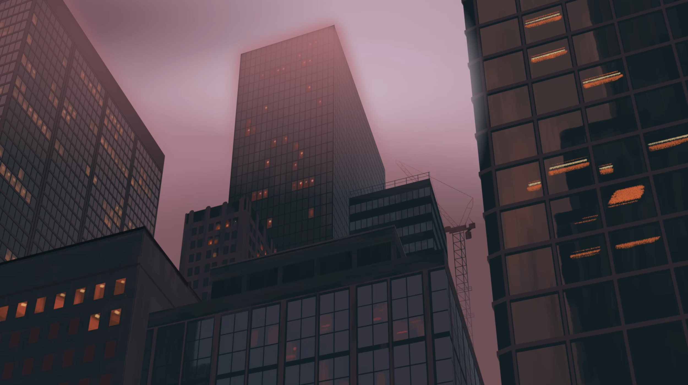
