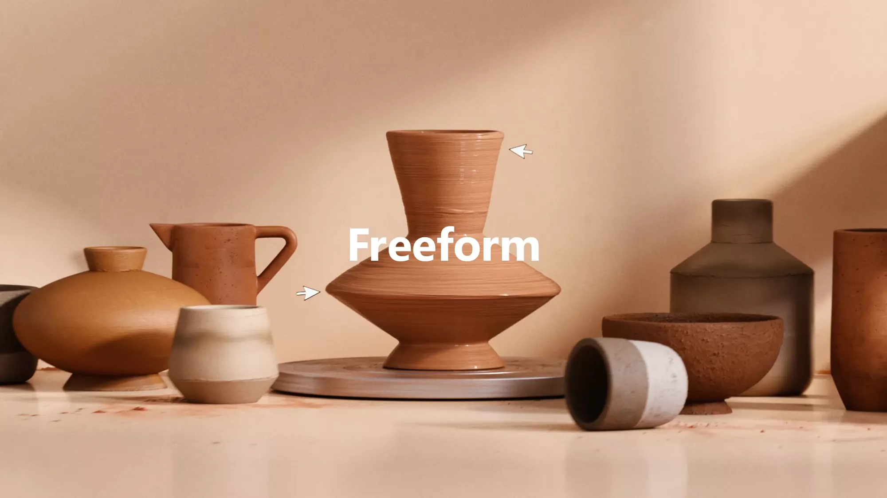
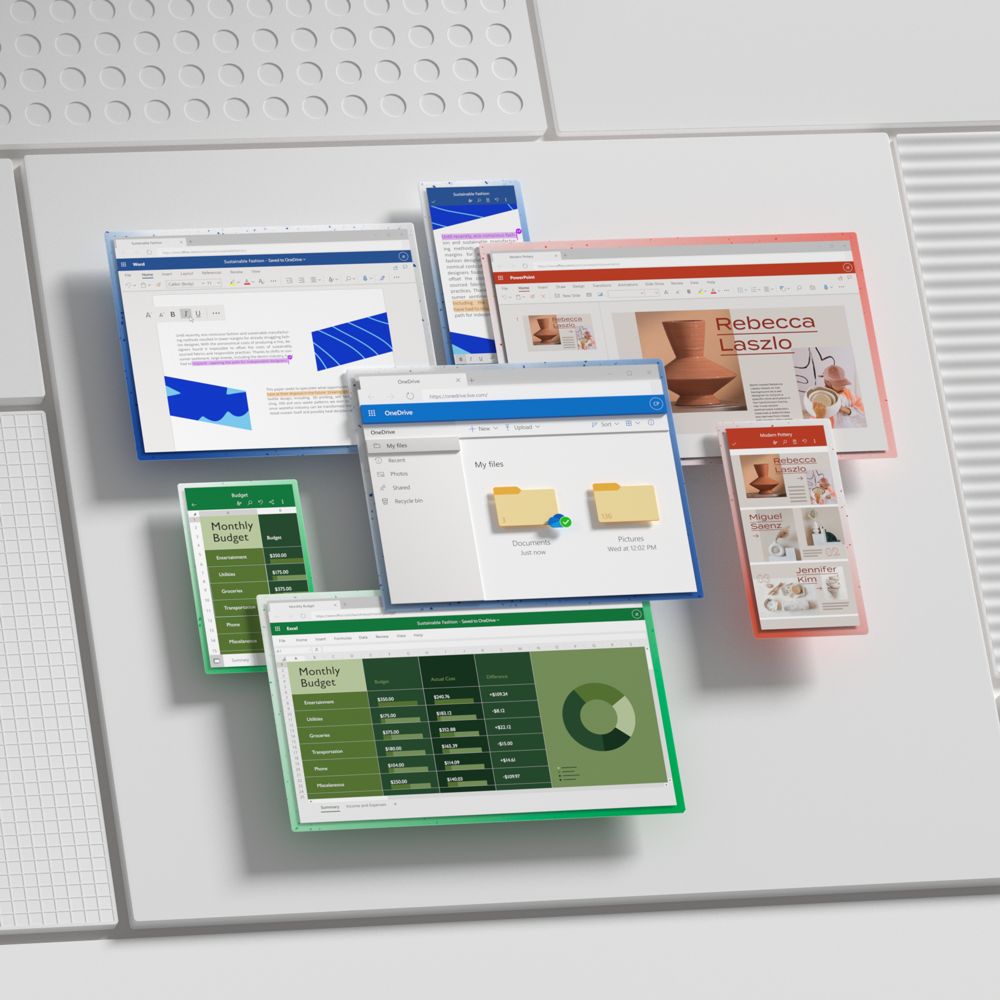
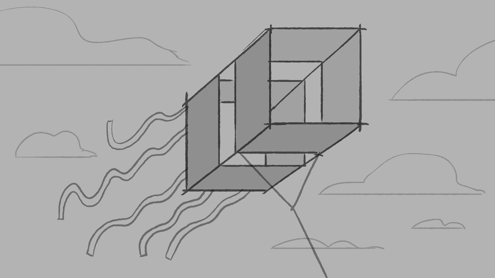
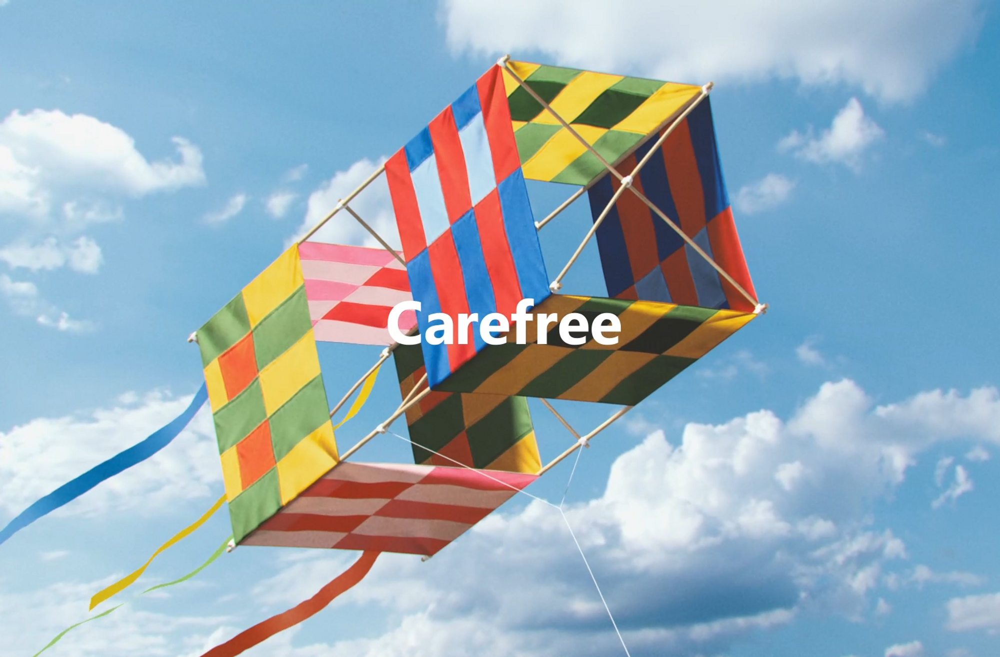
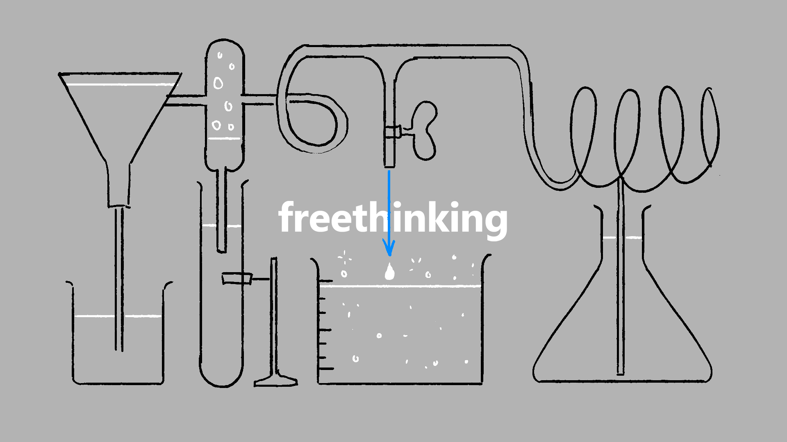
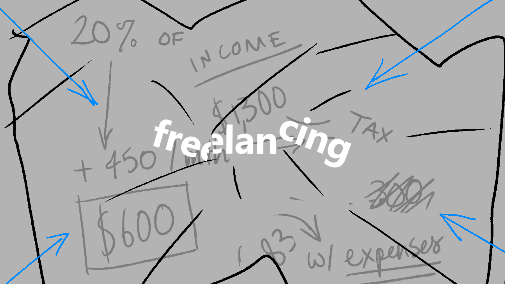

# Microsoft — 365

[Video — video-01-fb4cc12f-e209-441a-bbe8-f103378cb1cb.mp4 (Squarespace-hosted, 30s)](./microsoft-365/video-01-fb4cc12f-e209-441a-bbe8-f103378cb1cb.mp4)

*Role:* Art Director

*Studio:* BUCK

*Client:* Microsoft

Microsoft’s full suite of productivity software has always been well known, but in an era of increasingly remote teams, collaboration was a more important aspect than ever.

Our team at BUCK brought all of these collaborative features to life in a way that combined dimensional product UI with a playful mixed media approach. Showing each tool being used in a whole myriad of ways.

A broad suite of tools called for a broad range of stylistic approaches. We used a combination of hand-drawn 2D design & animation, along with textural 3D scenes, to create varied representations of each of the key features we were highlighting.

These were combined with richly tactile user interface elements, lifting off the screen. This allowed us to bring further focus and emphasis to key elements, while still keeping one foot grounded in the realism of the software itself.

## Credits

**Executive Creative Director**
Orion Tait

**Group Creative Director**
Thomas Schmid

**Executive Producer**
Joe Nash

**Associate Creative Directors**
Chris Palazzo, Stevie Watkins

**Producer**
Alex Decaneas

**3D Design Director**
Chris Phillips

**Art Director**
Doug Hindson

**Copywriter**
Logan O'Brien

**Design**
Anthony Furlong, Ben Hill, Carmel Gatchalian, Ege Soyuer, Guillermo Zapiola, Hogan Williams, João Lavieri, Johan Eriksson, Pierre-Nicolas Riou, Will Burkart

**3D Animation**
Chris Ribar, Dan Darling, Diego Diapolo, Hogan Williams,Will Burkart, Yili Orana

**2D Animation**
Gilles Desmadrille, Johan Eriksson, Paola Chen Li

**Cel Animation**
Adam Henderson, Mercy Lomelin, Vincent Tsui

**Post**
Jose Fuentes, Paal Rui
