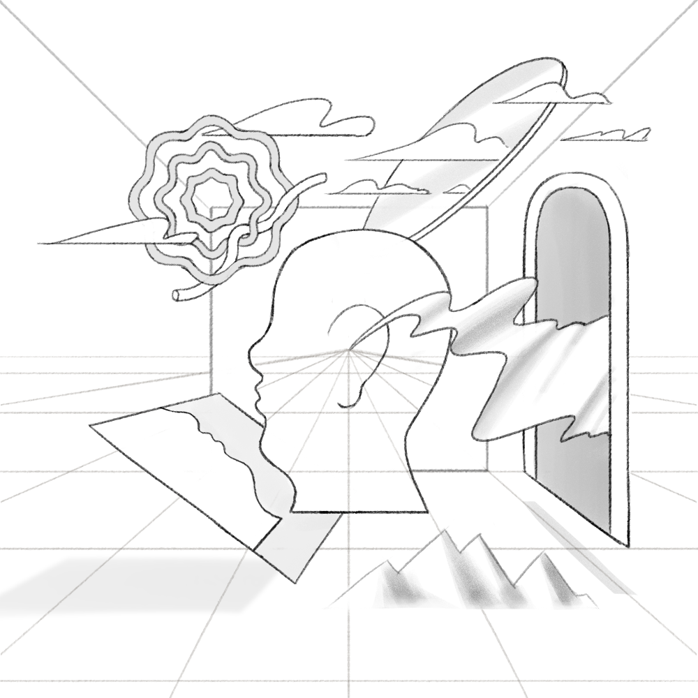
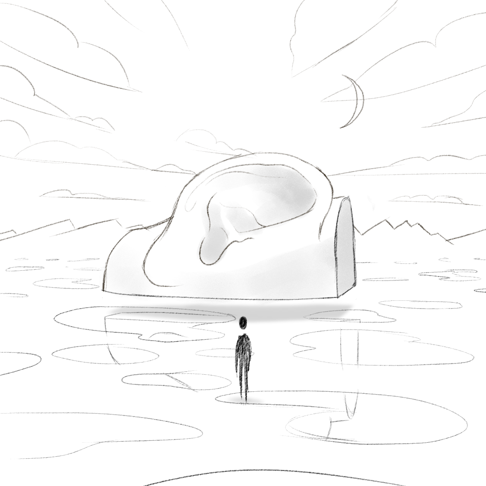
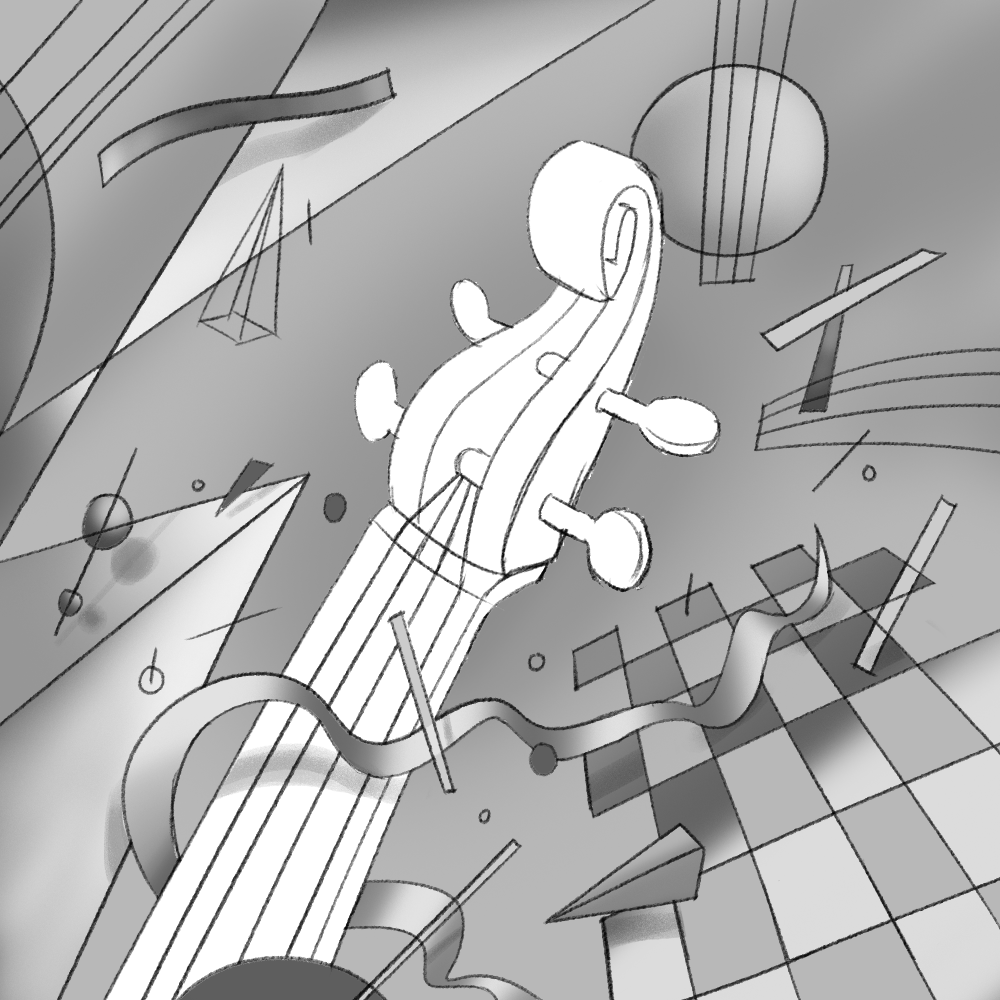

# Spotify — Premium

[Video — video-01-69239f6f-3a24-4be6-b2b2-ffcf0e23bdaa.mp4 (Squarespace-hosted, 10s)](./spotify-premium/video-01-69239f6f-3a24-4be6-b2b2-ffcf0e23bdaa.mp4)

*Role:* Concept Design

*Studio:* BUCK

*Client:* Spotify

Made in collaboration with Spotify’s in-house creative team, we created a series of stills and animated images to celebrate the panoply of musical genres you’ll find on the music streaming service.

I worked on concepting ideas for a selection of genres — ambient, classical and Indian classical. Drawing on aspects of album cover design, the instruments used to make the music, and the influence of surrealist painters.

The rest of the design team then took those initial sketches and developed them into vibrant, detailed illustrations, which were in turn brought to life through hypnotic animated loops.

[Video — video-02-fcd4b707-7907-4372-a9ae-4df9b26cc1ed.mp4 (Squarespace-hosted, 10s)](./spotify-premium/video-02-fcd4b707-7907-4372-a9ae-4df9b26cc1ed.mp4)

## Credits

**Group Creative Director**
Thomas Schmid

**Executive Producer**
Joe Nash

**Associate Creative Director**
Kyle Strope

**Senior Producer**
Russell Greene

**Producer**
Tracey McDonough

**Art Director**
Debora Cruchon
Kyle Strope

**Animation Director**
Chad Colby

**Design**
Brendi Wedinger, Debora Cruchon, Doug Hindson, Emily Suvanvej, Fede Reano, Hyung Soon Joo, Kuu Chen, Pierre-Nicolas Riou, Sandro Rybak, Shannon Rollins, Thomas Schmid, Twisha Patni, 3D Animation, Fede Reano, Michael Russo

**2D Animation**
Dan Cantelm, Fabien Rousseau, Johan Eriksson, Melissa Miyamoto-Mills, Mercy Lomelin, Paola Chen, Vero Gómez
