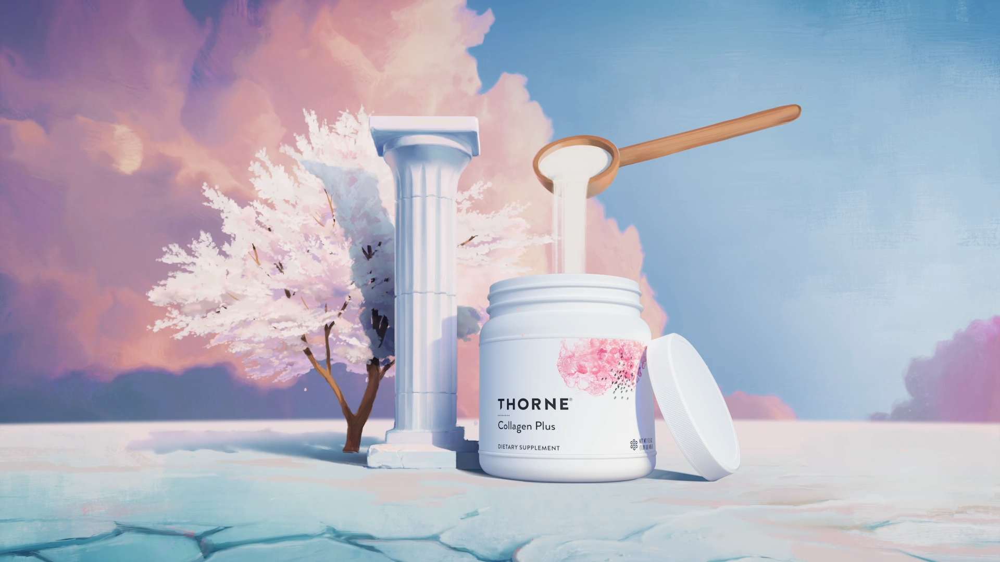
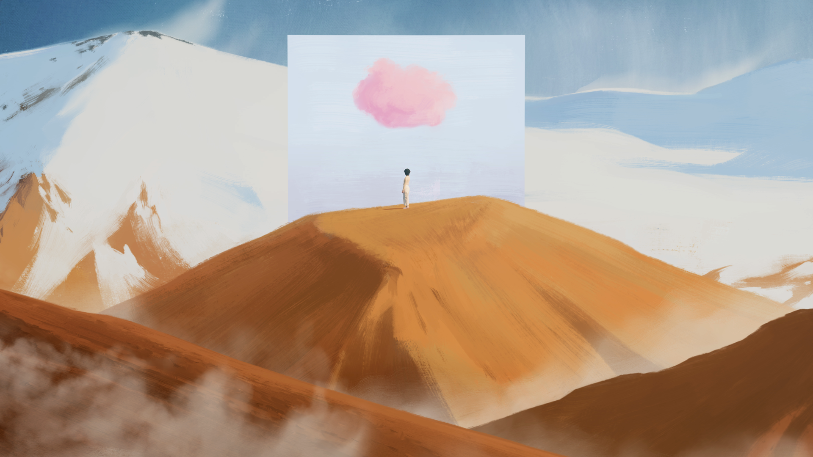
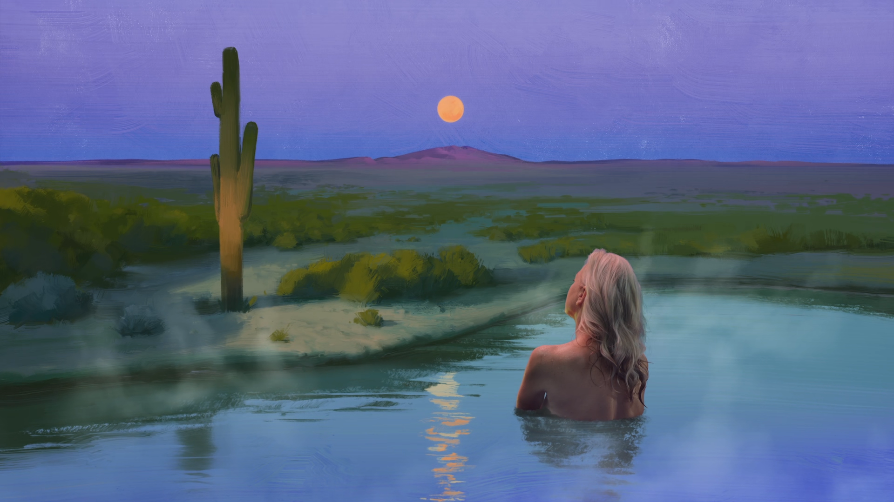
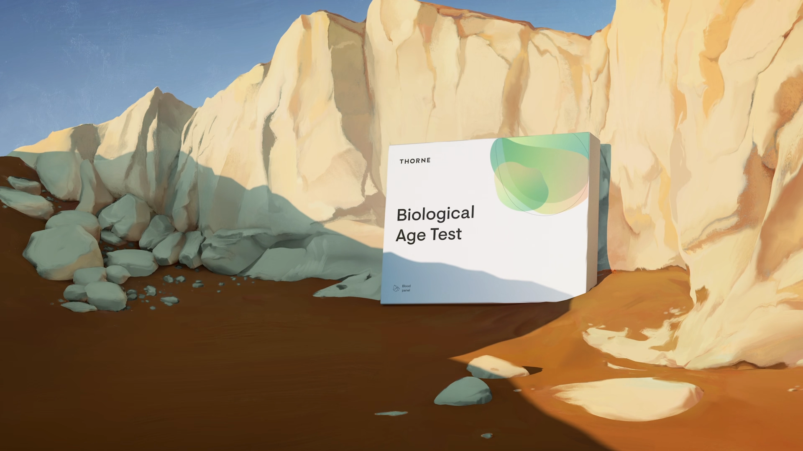
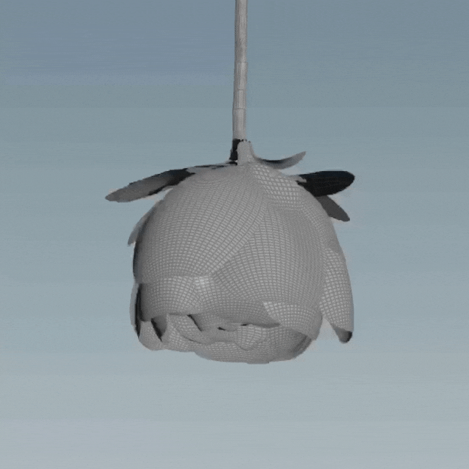
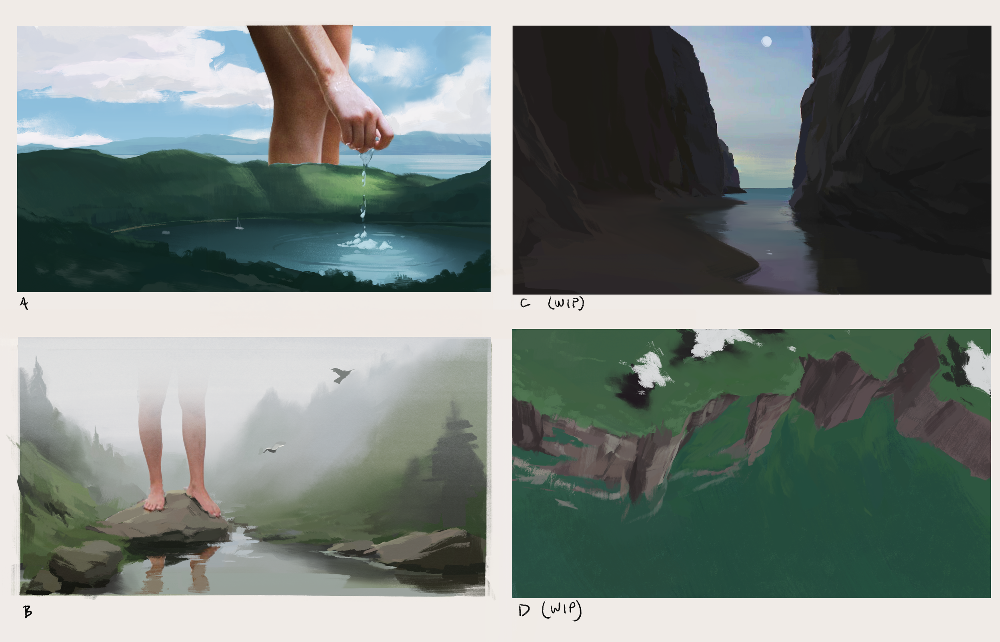
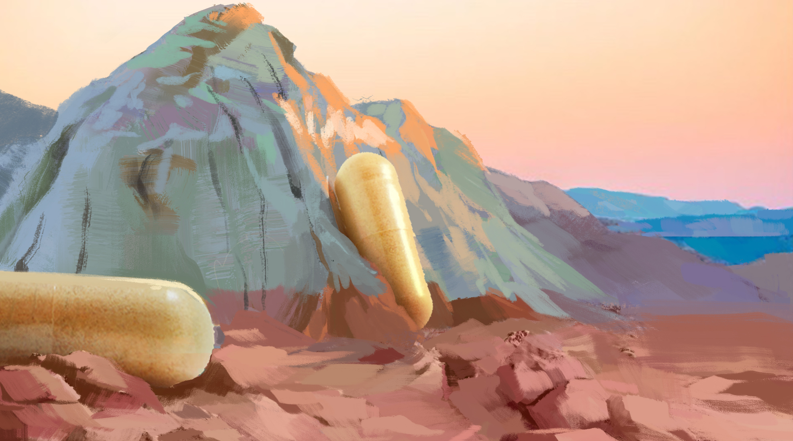
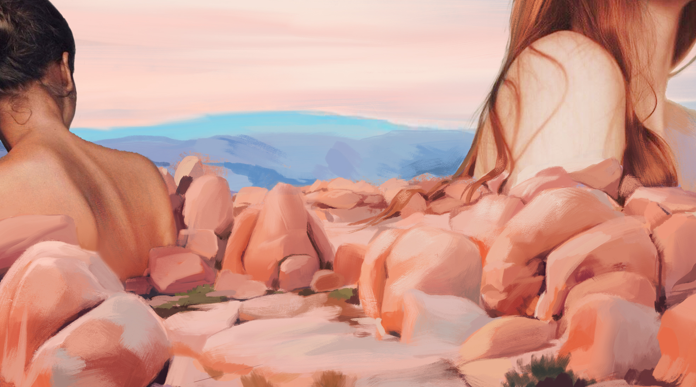
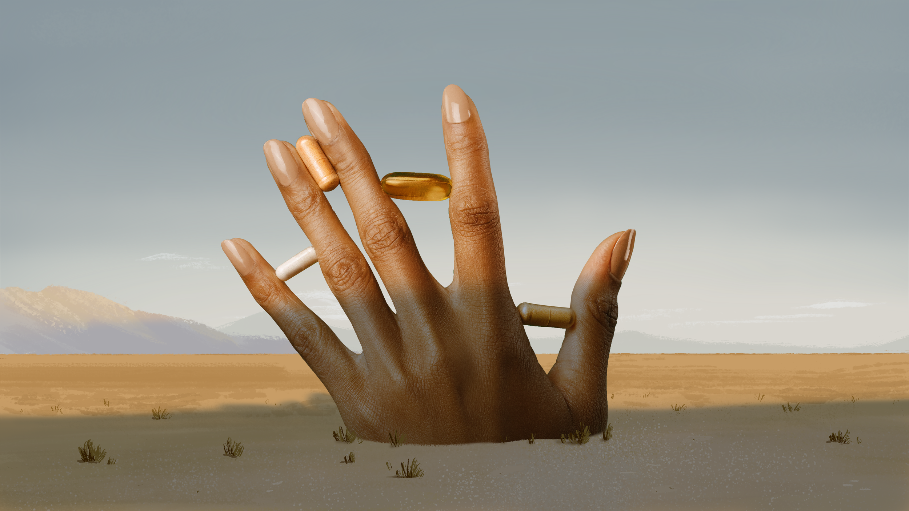
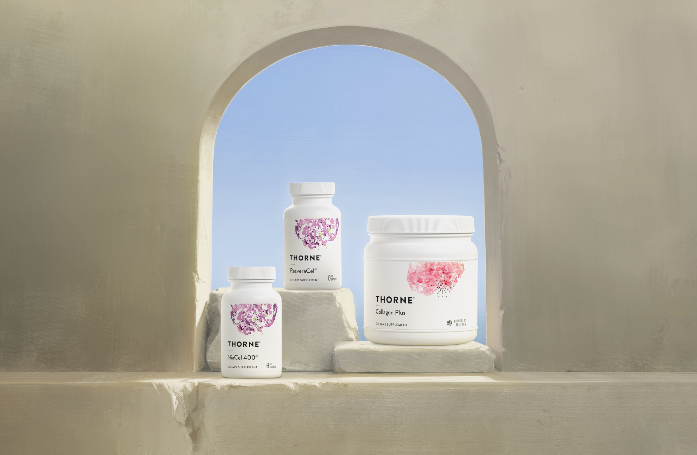

# Thorne — Healthy Aging

[Video — video-01-5164b0be-3588-4d6d-a233-b0cd7123b7b5.mp4 (Squarespace-hosted, 60s)](./thorne-healthy-aging/video-01-5164b0be-3588-4d6d-a233-b0cd7123b7b5.mp4)

*Role:* Art Director

*Studio:* BUCK

*Client:* Thorne

Through a novel combination of painting, live-action, and 3D, BUCK told told a poetic story about healthy aging for Thorne.

Steering away from traditional supplement commercials’ obsession with “anti-aging,” we focused instead on an aspirational view of healthy aging that delivers a holistic lifestyle, rather than a cure.

Playing with scale and surrealism, we created a set of sublime environments for real people to inhabit as we told our story.

The paintings themselves set the tone for each of the scenes, meaning the 3D elements needed to feel integrated and embedded with each landscape.

Matching lighting between the painted world and our 3D objects helped to unify each environment. As well as modeling the products, we also used 3D to bring depth to landscape elements in scenes with dynamic cameras, adding parallax and a sense of depth where it was needed.

Our starting point was loose painting exploration —playing with ways to integrate humans and objects in natural landscapes in a way that pushed scale, lighting and saturation.

We took inspiration from Surrealist masters like Magritte & Dali, as well as Romanticists like Caspar David Friedrich, where landscapes tell as much of a story as the people and objects within them.

Creating a mood film of footage of the natural world showed us locations for exploration and started to give us a sense of pacing and camera movement.

We also used some cutting edge machine learning (EBSynth) to apply our painted style to some complex elements, like clouds and water.

[Video — video-02-f2ebd821-50cc-4d68-97b2-8b7bbebb56f8.mp4 (Squarespace-hosted, 4s)](./thorne-healthy-aging/video-02-f2ebd821-50cc-4d68-97b2-8b7bbebb56f8.mp4)

## Credits

**Executive Creative Director**
Ben Langsfeld

**Executive Producer**
Joe Nash

**Directors**
Doug Hindson
Liron Eldar-Ashkenazi

**Lead Producer**
Jess Pierik

**Matte Painting**
Doug Hindson
Fernando Utreras
Wesley McClain

**2D Animation**
David Hobizal
Federico Saenz Recio
Gilles Desmadrille
Po-Chen Chia

**CG Animation**
Chris Ribar
Daniela Portilla
Filipe Machado
John Karian
Joy Tien
Shane O'Hara

**Editorial**
Audrey McHale
Cameron Kelly
Talia Mazzarella

**Colorist**
Jose Fuentes

**Compositing**
Lurival Jones
Navid Bagherzadeh

**Production Coordinator**
Jennifer Blackwell

**Copywriter**
Logan O'Brien

**Head of Live Action Production**
Trish Rigby

**Live Action Directors**
Doug Hindson
Liron Eldar-Ashkenazi

**DP**
Derek McKane

**VFX Supervisor**
Chris Ribar

Line Producer
Brian Bennhoff

**Production Designer**
Wayne Neho

**Wardrobe Stylist**
Bree Perry

**Hair & Makeup**
Jamie Bednarchick

**1st AD**
Marco Ajello

**Music, Sound Design, VO & Mix**
Antfood

**Executive Creative Director**
Wilson Brown

**Executive Producer**
Sue Lee

**Composer, Sound Designer, & Mix Engineer**
Spencer Casey

**Senior Producer**
Jennifer Fife

**Production Coordinator**
Charlie Blasberg
