# Transportation Alternatives

[Video — video-01-e0ad42be-e979-4720-9810-a857a45679fc.mp4 (Squarespace-hosted, 87s)](./transportation-alternatives/video-01-e0ad42be-e979-4720-9810-a857a45679fc.mp4)

*Role:* Associate Creative Director, Design

*Studio:* BUCK

*Client:* Transportation Alternatives

To accompany the release of Transportation Alternative’s new Spatial Equity NYC tool, Buck created a short film that highlights how data can reveal the inequities across NYC streets and city planning — and provide positive solutions for the people of New York.

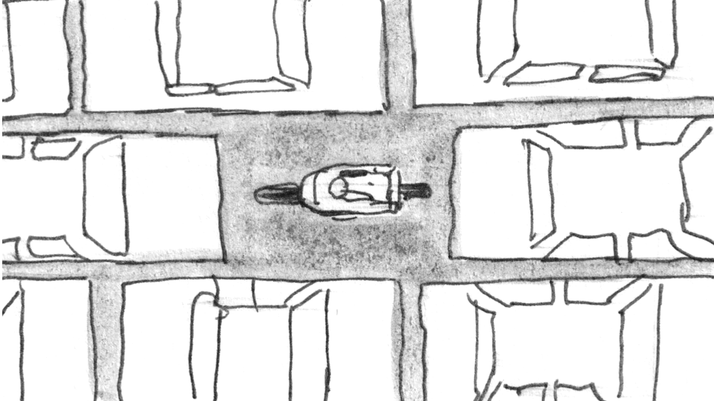
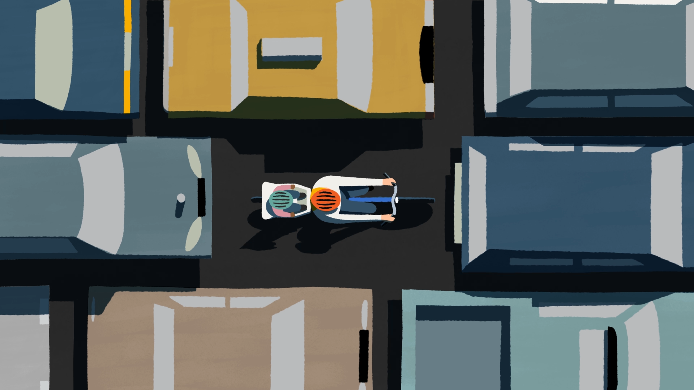
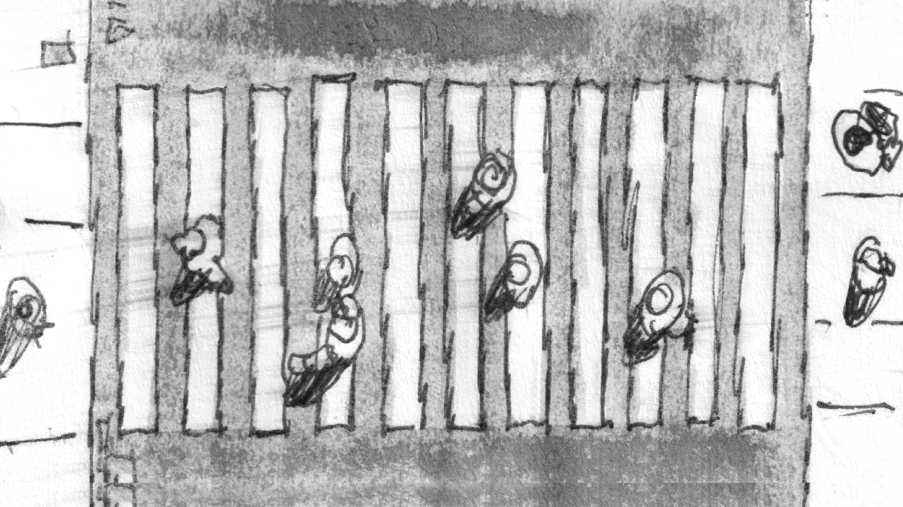
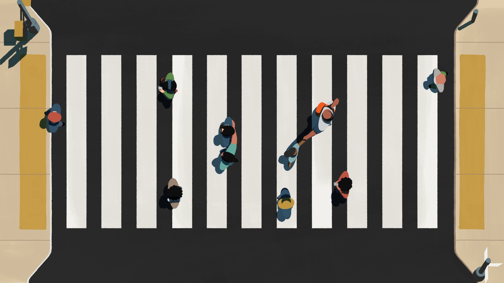

Some streets are wide and leafy, others narrow and steamy, and the rest are famously congested. One size does not fit all in New York’s terra firma.

Those differences, though, can create inequitable consequences for its citizens, and Transportation Alternatives have been working with MIT on a tool that aims to reveal those disparities.

The tool, Spatial Equity NYC, uses publicly-available data to measure, compare, and visualise different types of public space—from streets to bus lanes to parks—between neighbourhoods.

That data is then paired with demographic data, from street-level to city wide. The hope is that the tool will be utilised by New Yorkers from all walks of life to improve the streets and make the city safer and fairer for everyone.

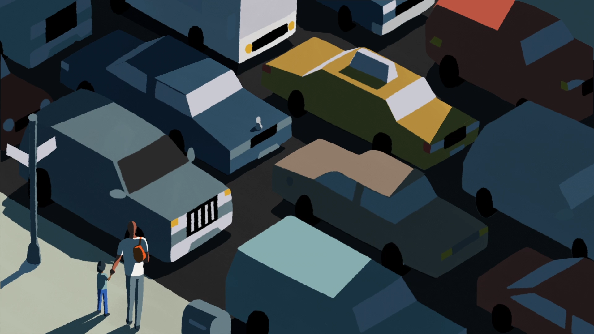
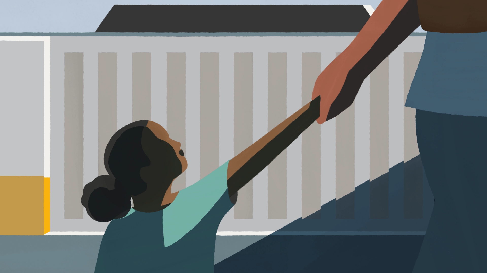
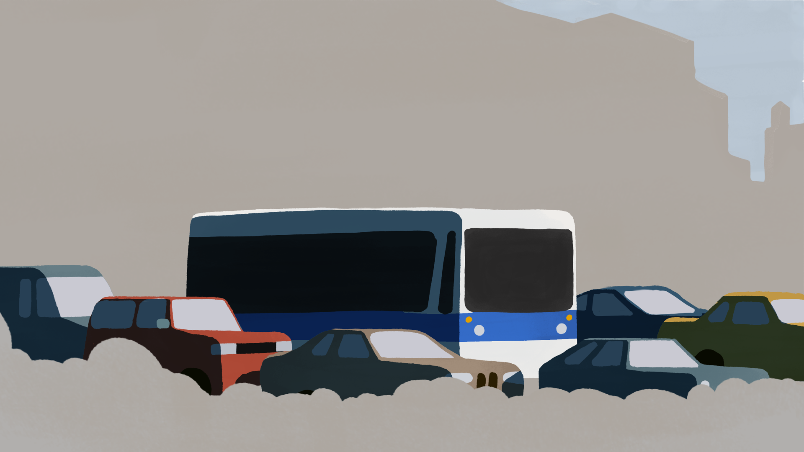
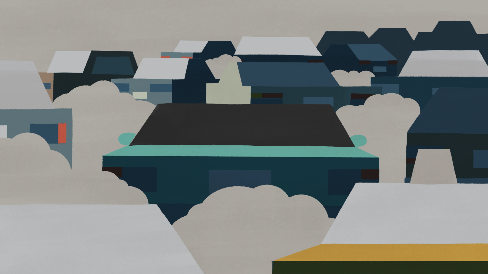
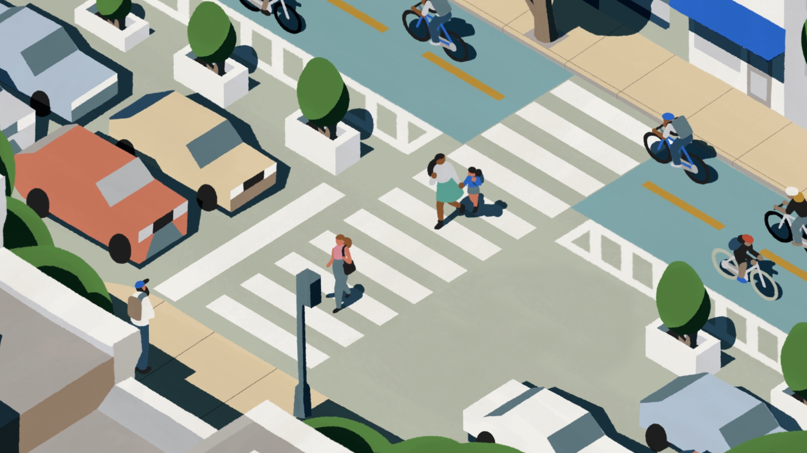

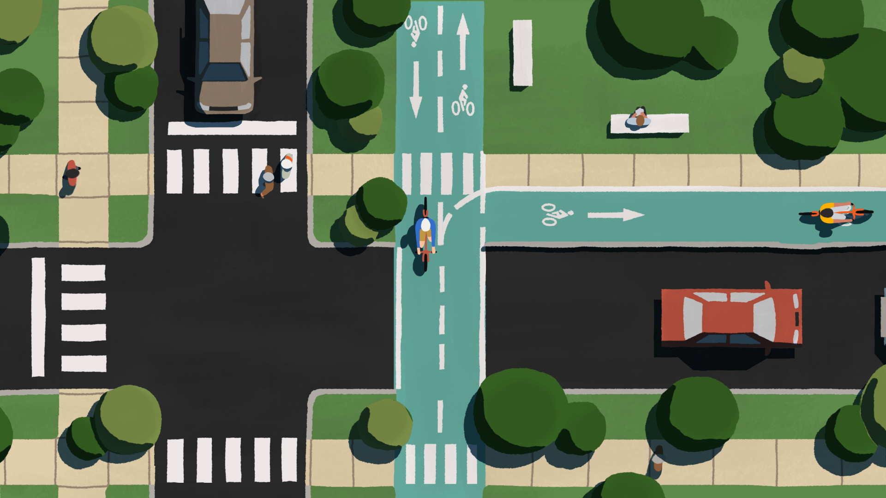
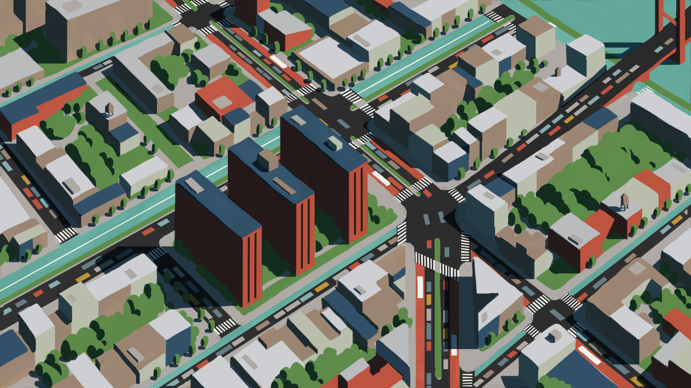

We separated our story into four different threads following characters and the common problems they face in the city. After establishing each scenario, we then see problems become solutions, all brought together by our loose visual interpretation of the data.

The film uses dramatic lighting to help communicate its themes. There’s a dark, foreboding feeling to the setup of the city’s spatial problems, but as the film provides ideas and solutions, the lighting brightens, full of optimism and hope.

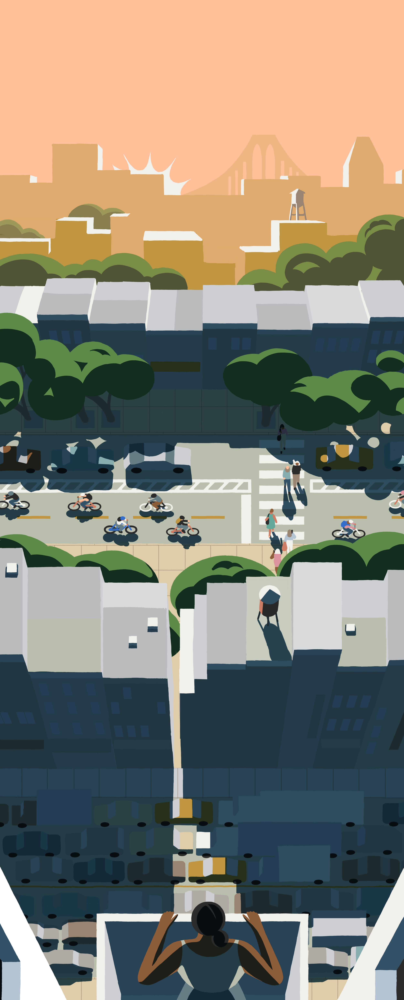

## Credits

**Executive Creative Director** Ben Langsfeld

**Executive Producer** Kim Stephens

**Creative Director**
Ege Soyuer

**Head of Strategy**
Marla Moore

**Producer**
Dani Ramirez
Tamara Campbell

**Associate Creative Director**
Doug Hindson

**2D Animation Lead**
Diego Abad

**Art Director**
Pierre-Nicolas Riou

**Design**
Diego Abad
Jose Flores
Doug Hindson

**Senior 2D Animator**
Vero Gomez

**Junior 2D Animator**
Meitar Almog

**2D Apprentice**
Yinan Liang

**2D Animation**
Tucker Klein

**Music & Sound Design**
Ambrose Yu

**Head of Copy**
David Evans

**Senior Copywriter**
Josephine Heintz
